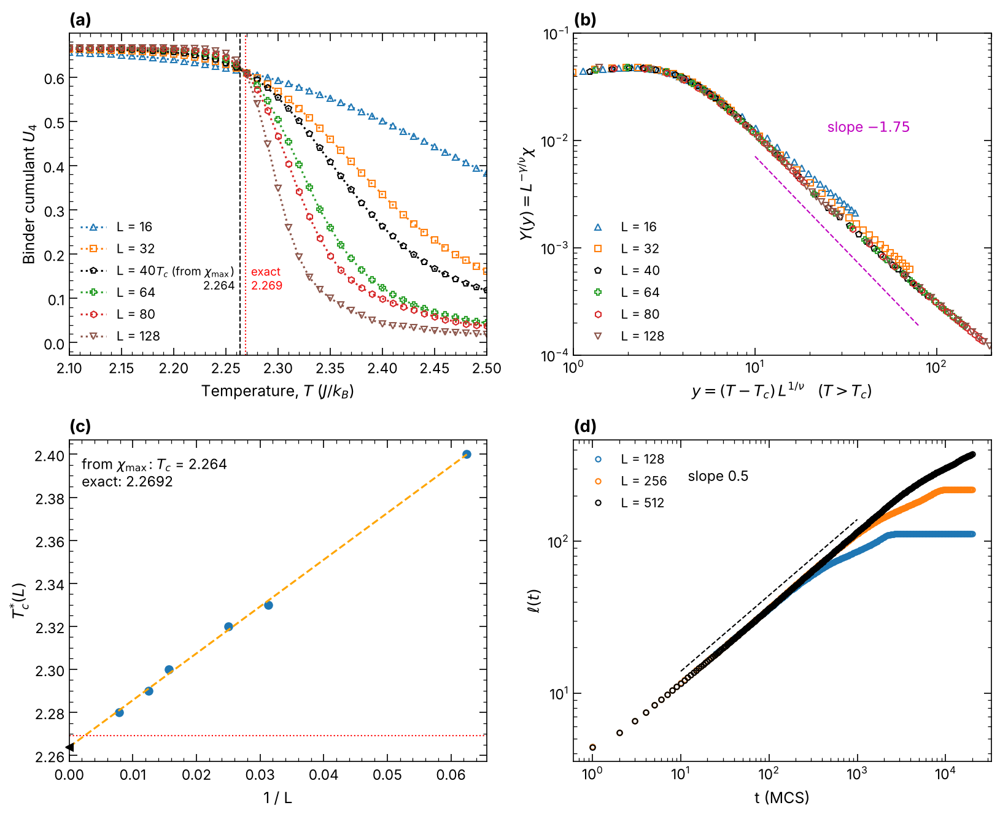
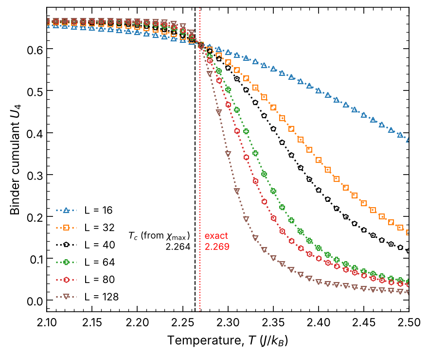
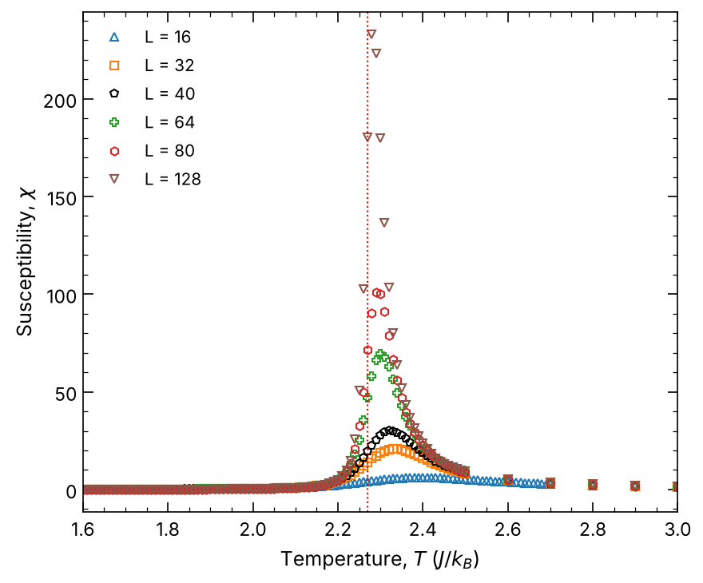
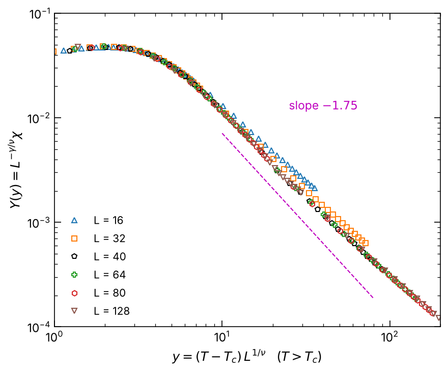
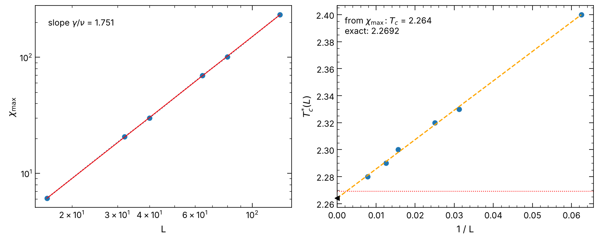
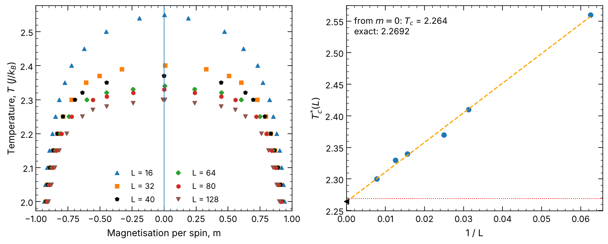
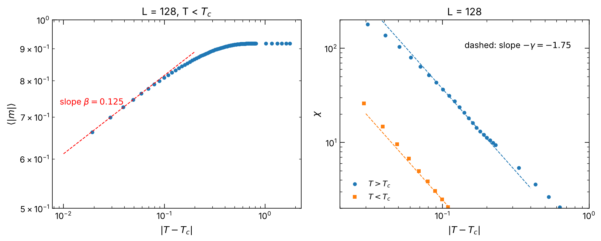
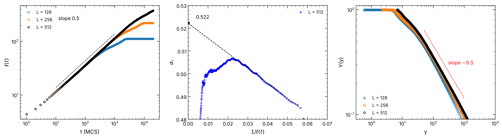

# 2D Ising Model: Critical Phenomena and Phase-Ordering Kinetics

Monte Carlo simulation of the two-dimensional Ising model. The code studies the continuous (second-order) ferromagnetic transition and the non-equilibrium growth of ordered domains after a quench. The critical temperature and critical exponents are extracted by finite-size scaling of the susceptibility, the magnetisation and the fourth-order Binder cumulant. The domain-growth law is also verified. The results are compared with the exact solution of the model.

The simulation (Metropolis algorithm) is written in C++ and parallelised over independent random seeds with OpenMP. A Python/Numba reference implementation of the same algorithm is included, together with the code for the domain-growth study and the analysis.



*(a) Binder cumulant for six lattice sizes; the curves cross near the critical temperature. (b) Collapse of the susceptibility onto one curve, $T > T_c$. (c) Extrapolation of the susceptibility-peak temperature to infinite size. (d) Growth of the average domain size after a quench.*

## Results

All numbers below are computed by the code in this repository from the stored data in `data/dissertation/` (`python scripts/make_figures.py data/dissertation` prints them and saves them in `results/dissertation/summary.txt`). Temperatures are in units of $J/k_B$.

| Quantity | This work | Exact |
|---|---|---|
| $T_c$ from the susceptibility peaks, extrapolated to $L \to \infty$ | 2.264 | 2.2692 (Onsager) |
| $T_c$ from the $m = 0$ temperatures of the phase diagram, extrapolated | 2.264 | 2.2692 |
| $T_c$ from the crossing of the Binder cumulant curves | 2.264 | 2.2692 |
| $\gamma/\nu$ from $\chi_{\max} \propto L^{\gamma/\nu}$ | 1.751 | 1.75 |
| Growth exponent $\alpha$, $L = 512$, extrapolated to $1/\ell \to 0$ | 0.522 | 0.5 |

The extrapolated values are the intercepts of straight-line fits to the lattice-size data (see the figures below). The Binder crossing is read from the plot. The $m = 0$ temperatures of the phase diagram were read by eye from the magnetisation histograms and are stored in `data/dissertation/` (see [Limitations](#limitations)).

## Background

**The model.** The Ising model describes a ferromagnet as a lattice with a spin $\sigma_i = \pm 1$ on every site. For nearest-neighbour interaction and an external field $h$ the energy is

$$\mathcal{H} = -J\sum_{\langle ij\rangle}\sigma_i\sigma_j - h\sum_i \sigma_i$$

where $J$ is the coupling constant and the first sum runs over neighbouring pairs. For $J > 0$ parallel spins are favoured (ferromagnet). At high temperature entropy dominates and the spins fluctuate (paramagnet, zero net magnetisation). Below the Curie (critical) temperature $T_c$ the system magnetises spontaneously. This code uses a square lattice of $L \times L$ spins with periodic boundaries, $h = 0$ and $J = k_B = 1$.

**Order parameter.** The magnetisation per spin $m = \frac{1}{L^2}\sum_i \sigma_i$ is zero above $T_c$ and non-zero below it. Below $T_c$ there are two equivalent ordered states, $m > 0$ and $m < 0$ (spontaneous symmetry breaking).

**Critical exponents and universality.** Near $T_c$ the correlation length $\xi$ diverges and the system loses any length scale. Thermodynamic quantities then follow power laws in the reduced temperature $t = (T - T_c)/T_c$:

| Quantity | Behaviour | 2D Ising exponent |
|---|---|---|
| correlation length | $\xi \sim \lvert t\rvert^{-\nu}$ | $\nu = 1$ |
| magnetisation | $m \sim (T_c - T)^{\beta}$ | $\beta = 1/8$ |
| susceptibility | $\chi \sim \lvert T - T_c\rvert^{-\gamma}$ | $\gamma = 7/4$ |

Systems with the same dimensionality and symmetry share the same exponents (universality class).

**Finite-size scaling.** In a finite lattice $\xi$ cannot exceed $L$, so $\chi$ does not diverge but has a rounded peak, whose position moves towards $T_c$ and whose height grows with $L$:

$$\chi_{\max} \sim L^{\gamma/\nu}, \qquad T_c^{*}(L) = T_c + b\,L^{-1/\nu}$$

The exponent ratio $\gamma/\nu$ is the slope of $\ln\chi_{\max}$ against $\ln L$, and $T_c$ is the intercept of the peak temperature $T_c^{*}(L)$ plotted against $L^{-1/\nu}$ (a straight line against $1/L$ for $\nu = 1$). If the scaling is right, the curves for all $L$ collapse onto one curve when $\chi L^{-\gamma/\nu}$ is plotted against $(T - T_c)L^{1/\nu}$. The Binder cumulant

$$U_4 = 1 - \frac{\langle m^4\rangle}{3\langle m^2\rangle^2}$$

is dimensionless, so its curves for different $L$ cross at $T_c$. It tends to $2/3$ in the ordered phase and to $0$ in the disordered phase.

**Phase-ordering kinetics.** When the system is quenched from a disordered state to a temperature well below $T_c$, it does not reach equilibrium. Instead domains of the two ordered phases form and grow. The growth is described by one characteristic length $\ell(t)$, the average domain size, with $\ell(t) \sim t^{\alpha}$. For a non-conserved scalar order parameter (the case here) $\alpha = 1/2$ (Allen–Cahn / Lifshitz theory). At late times the domain pattern is statistically the same at all times when lengths are measured in units of $\ell(t)$. In a finite lattice the domains stop growing when they reach the lattice size, which allows a finite-size scaling analysis of the same type as above.

## Method

### Metropolis algorithm

For one lattice of $L \times L$ spins with random initial values, repeat:

1. Choose a random site $i$.
2. Compute the energy change $\Delta E$ of flipping its spin. In 2D, $\Delta E = 2\sigma_i \sum_{\text{neighbours}} \sigma_j$ can only be $-8, -4, 0, 4$ or $8$.
3. If $\Delta E \le 0$, flip the spin. Otherwise flip it with probability $e^{-\Delta E/T}$: draw a random number $r$ in $[0, 1)$ and flip if $r < e^{-\Delta E/T}$.
4. When a spin flips, update the total magnetisation $M$ by $2\sigma_i$, where $\sigma_i$ is the spin *after* the flip. $M$ and the energy are updated incrementally and never recomputed.

A **Monte Carlo step** in this code is one single-spin flip attempt. $L^2$ steps make one sweep (one **MC sweep**). Step counts below are in single-spin attempts; the sweep counts are given in a separate table.

### Equilibrium study (simulated annealing)

For each seed the program starts from a random lattice at the highest temperature and visits 131 temperatures from $T = 4.5$ down to $T = 0.5$. Each temperature starts from the final state of the previous one. The spacing is dense near $T_c$:

| Range | Step | Points |
|---|---|---|
| 4.5 … 2.6 | 0.10 | 20 |
| 2.5 … 1.46 | 0.01 | 105 |
| 1.25 … 0.5 | 0.15 | 6 |

The $L = 16$ files in `data/dissertation/` were made with a slightly different grid of 150 temperatures (steps of 0.10 from 4.5 to 2.8, steps of 0.01 from 2.7 to 1.45, then the same six points). The other files use the 131-point grid above, and so do all new runs of the program.

At each temperature the first part of the run is discarded for equilibration, and the magnetisation per spin is then recorded at regular intervals. Close to $T_c$ the system fluctuates strongly and relaxes slowly, so equilibration and the interval between recordings are longest there ($2.0 \le T \le 2.5$), to keep the recorded values uncorrelated. There are 5000 recordings per temperature. The settings in `get_steps()` of the C++ files are given below, first in single-spin attempts (MC steps) and then in sweeps. In each cell the numbers are the equilibration steps, the total number of steps at that temperature, and the measurement interval.

**MC steps** (single-spin flip attempts; $M$ = million):

| L | $T > 2.5$: equilibration / total / interval | $2.0 \le T \le 2.5$: equilibration / total / interval | $T < 2.0$: equilibration / total / interval | Recordings per $T$ |
|---|---|---|---|---|
| 16 | 0.5 M / 3 M / 500 | 7 M / 132 M / 25 000 | 0.3 M / 5.3 M / 1 000 | 5000 |
| 32 | 0.5 M / 3 M / 500 | 30 M / 155 M / 25 000 | 0.3 M / 5.3 M / 1 000 | 5000 |
| 40 | 0.5 M / 5.5 M / 1 000 | 50 M / 300 M / 50 000 | 0.3 M / 5.3 M / 1 000 | 5000 |
| 64 | 0.5 M / 3 M / 500 | 50 M / 550 M / 100 000 | 0.3 M / 5.3 M / 1 000 | 5000 |
| 80 | 3 M / 158 M / 31 000 | 200 M / 1 450 M / 250 000 | 3 M / 78 M / 15 000 | 5000 |
| 128 | 3 M / 503 M / 100 000 | 300 M / 10 300 M / 2 M | 3 M / 253 M / 50 000 | 5000 |

**MC sweeps** (the same settings divided by $L^2$, rounded to a whole number; a measurement interval shorter than one sweep is written as $<1$, since the program counts in single attempts and, for example, 500 attempts at $L = 64$ is only 0.12 sweeps):

| L | $T > 2.5$: equilibration / total / interval | $2.0 \le T \le 2.5$: equilibration / total / interval | $T < 2.0$: equilibration / total / interval | Recordings per $T$ |
|---|---|---|---|---|
| 16 | 1 953 / 11 719 / 2 | 27 344 / 515 625 / 98 | 1 172 / 20 703 / 4 | 5000 |
| 32 | 488 / 2 930 / <1 | 29 297 / 151 367 / 24 | 293 / 5 176 / <1 | 5000 |
| 40 | 312 / 3 438 / <1 | 31 250 / 187 500 / 31 | 188 / 3 312 / <1 | 5000 |
| 64 | 122 / 732 / <1 | 12 207 / 134 277 / 24 | 73 / 1 294 / <1 | 5000 |
| 80 | 469 / 24 688 / 5 | 31 250 / 226 562 / 39 | 469 / 12 188 / 2 | 5000 |
| 128 | 183 / 30 701 / 6 | 18 311 / 628 662 / 122 | 183 / 15 442 / 3 | 5000 |

For any other $L$ the program calculates the settings automatically by scaling the $L = 64$ values to the new lattice size: the larger the lattice, the longer the equilibration and the measurement interval. Look at the energy plot (energy against the step number) for the new $L$ to check that the equilibration is long enough, and edit `get_steps()` if it is not.

From the recorded values $m$ the program computes, per temperature,

$$\langle m\rangle,\quad \langle \lvert m\rvert\rangle,\quad \chi = \frac{L^2\left(\langle m^2\rangle - \langle \lvert m\rvert\rangle^2\right)}{T},\quad U_4 = 1-\frac{\langle m^4\rangle}{3\langle m^2\rangle^2}.$$

The whole run is repeated for 2000 independent random seeds (seeds 1 to 2000) for each lattice size, and the results are averaged over the seeds. 

### Domain growth

The lattice is quenched from a random state (infinite temperature) to $T = 0.5$ and run for 20 000 sweeps. The average domain size is

$$\ell(t) = \frac{2N}{\ell_x + \ell_y}$$

where $N = L^2$ and $\ell_x$, $\ell_y$ are the total numbers of domain walls (neighbouring spins that differ) along the $x$ and $y$ directions. $\ell(t)$ is measured at 351 logarithmically spaced times. The growth exponent follows from the instantaneous exponent $\alpha_i = d\ln\ell/d\ln t$ plotted against $1/\ell$ and extrapolated to $1/\ell \to 0$. The finite-size scaling uses

$$y = \frac{(\ell_{\max}-\ell_0)^{1/\alpha}}{t-t_0},\qquad Y(y) = \frac{\ell(t)-\ell_0}{\ell_{\max}-\ell_0}$$

where $t_0$ is the time the first domains take to form, $\ell_0$ the domain size then, and $\ell_{\max}$ the largest domain size a lattice of this size can reach.

### Parallelisation

The temperature loop of one seed is serial, since every temperature starts from the previous state. Different seeds are completely independent, so the C++ programs distribute them over the CPU cores with OpenMP (`schedule(dynamic, 1)`: a thread that finishes a seed takes the next free one). Each seed has its own random number generator seeded with the seed number, so the output of a seed does not depend on how many threads are used. The domain-growth script distributes its seeds over worker processes in the same way.


## Repository layout

```
cpp/ising.cpp             Metropolis simulation, OpenMP over seeds (C++), L a power of 2
cpp/ising_any_L.cpp       the same simulation for any L (e.g. 40, 80)
Makefile                  builds the C++ program for a chosen L and seed range (picks the right source)
src/ising/
    metropolis.py         Python/Numba reference version of the equilibrium simulation
    coarsening.py         domain-growth simulation (quench, domain length l(t))
    analysis.py           T_c, exponents, scaling collapses, growth exponent
    temperatures.py       temperature grids
scripts/
    average_seeds.py      average the per-seed output of the C++ program
    merge_distribution.sh merge the per-seed magnetisation files into one CSV
    convert_to_parquet.py convert the merged CSV to Parquet
    plot_distribution.py  magnetisation distribution curves
    run_coarsening.py     domain growth over many seeds
    coarsening_snapshots.py  snapshots of the lattice after a quench
    make_figures.py       all result figures from a folder of averaged results
tests/                    pytest tests
data/dissertation/        seed-averaged results used for the figures above
results/dissertation/     figures made from those results
```

The files in `data/dissertation/` are

| File | Content |
|---|---|
| `U_<L>.csv`, `Sus_<L>.csv`, `Abs_m_<L>.csv`, `m_<L>.csv` | Binder cumulant, susceptibility, $\langle \lvert m\rvert\rangle$ and $\langle m\rangle$ averaged over seeds, one value per temperature (highest temperature first). `Abs_m` exists for $L$ = 16, 32, 64, 128 and `m` for $L$ = 16, 32, 64 |
| `R_<L>_mean.csv` | domain size $\ell(t)$ averaged over seeds, $L$ = 128, 256, 512 |
| `phase_diagram_peaks.csv` | positions of the two peaks of the magnetisation distribution at each temperature, read by eye from the histograms |
| `pseudo_critical_m0.csv` | temperature $T_c^{*}(L)$ at which the distribution becomes single-peaked, read by eye |

## Installation

Requirements: Python 3.9 or newer and a C++ compiler with OpenMP (GCC).

1. Install a compiler (GCC and `make`):

   ```bash
   # Linux (Debian/Ubuntu)
   sudo apt install build-essential

   # macOS: the default compiler has no OpenMP, so install GCC
   brew install gcc               # then build with  make CXX=g++-14  (use the version number you got)

   # Windows: use WSL2 and follow the Linux instructions
   ```

2. Download the code and create a Python virtual environment:

   ```bash
   git clone https://github.com/rahul-r49/Ising2D-MC.git
   cd Ising2D-MC
   python3 -m venv .venv              # Windows (PowerShell): python -m venv .venv
   source .venv/bin/activate          # Windows (PowerShell): .venv\Scripts\activate
   ```


3. Install the package and its dependencies (numpy, pandas, matplotlib, numba, pytest):

   ```bash
   pip install -e ".[dev]"
   ```

   For the magnetisation distribution curves (optional) also install pyarrow: `pip install -e ".[dev,dist]"`.


## Usage

### Tests

```bash
pytest
```

See [Tests](#tests) below for what is checked.

### Equilibrium simulation (C++)

Build the program for a lattice size $L$ and a range of seeds, then run it. The example below runs seeds 1 to 8 for $L = 64$ on four threads and writes the output to the folder `runs/L64`:

```bash
make L=64 SEED_START=1 N_SEEDS=8
OMP_NUM_THREADS=4 ./build/ising_L64 runs/L64
```

`runs/L64` is the output folder. For another lattice size, change `L` in both lines, for example `make L=128 ...` and `./build/ising_L128 runs/L128`.

To try the whole chain in seconds first, build with `QUICK=1` (explained below):

```bash
make L=16 QUICK=1 N_SEEDS=2
OMP_NUM_THREADS=2 ./build/ising_L16_quick runs/quick
```

The program prints the number of single-spin flip attempts per seed, which can be used to estimate the run time. The speed depends on the machine, so time a run with `QUICK=1` or a small number of seeds first.

| Option | Meaning |
|---|---|
| `L` | lattice size (default 64). The Makefile uses `cpp/ising.cpp` for a power of 2 and `cpp/ising_any_L.cpp` otherwise; force one with `SRC=cpp/ising_any_L.cpp` |
| `SEED_START` | number of the first seed (default 1) |
| `N_SEEDS` | number of seeds (default 8) |
| `OMP_NUM_THREADS` | set when running the program (not when building): number of threads, i.e. how many seeds run at the same time (default: all cores, which counts hyper-threads, so set it to your physical core count) |
| `QUICK=1` | very short test schedule, see below |

Rules:
- Each seed runs on one thread, so use at most as many threads as the machine has **physical** cores, and no more threads than seeds.
- To run more seeds, build again with a different `SEED_START` so that the seed numbers do not repeat, and use the same output folder.
- The temperatures and the number of steps per temperature are set in `build_temp_array()` and `get_steps()` in `cpp/ising.cpp` (the same functions are in `cpp/ising_any_L.cpp`; change both if you use both). The comments there say what each number does.

Each seed `k` writes `m_<L>_<k>.csv`, `Abs_m_<L>_<k>.csv`, `Sus_<L>_<k>.csv`, `U_<L>_<k>.csv` (one value per temperature, highest temperature first) and `Run_no_<L>_<k>_Dist_Curve.csv` (every recorded magnetisation, one column per temperature).

**What `QUICK=1` does.** It replaces the real schedule by a very short one so that the whole chain (build, run, average, figures) can be tried in seconds. It uses the lattice size you give with `L` (for example `make L=16 QUICK=1`), the same 131 temperatures, and at every temperature 20 000 steps of equilibration followed by 2000 measurements 100 steps apart (220 000 steps in total, about 29 million attempts per seed). However, the results are far too noisy to use. The test suite uses this setting.

#### Checking the number of cores

```bash
# Linux / WSL: physical cores (nproc prints logical cores)
lscpu -p=CORE,SOCKET | grep -v '^#' | sort -u | wc -l

# macOS
sysctl -n hw.physicalcpu

# Windows (PowerShell)
(Get-CimInstance Win32_Processor | Measure-Object -Property NumberOfCores -Sum).Sum
```

#### Averaging the seeds

```bash
python scripts/average_seeds.py runs/L64 --L 64 --out data/my_run
```

This reads the per-seed files in `runs/L64` and writes `m_64.csv`, `Abs_m_64.csv`, `Sus_64.csv` and `U_64.csv` (the average over all seeds in the folder) to `data/my_run/`. Repeat for every lattice size, using the same `--out` folder.

### Figures

```bash
python scripts/make_figures.py data/my_run
```

The folder needs `Sus_<L>.csv` and `U_<L>.csv` for at least three lattice sizes; `Abs_m_<L>.csv` adds the magnetisation plot. That is enough to make the Binder, susceptibility, scaling-collapse and finite-size-scaling figures and the overview. The domain-growth figures (`R_<L>_mean.csv` files) and the phase diagram (`phase_diagram_peaks.csv` and `pseudo_critical_m0.csv`) are optional: they are made only when those files are in the folder, and are skipped otherwise. The figures and a text file with the headline numbers are saved in `results/my_run/`.

### Magnetisation distribution curves (optional)

The distribution curves need every recorded magnetisation, not the averages. They are made from the files `Run_no_*_Dist_Curve.csv` that the program writes for each seed in its output folder. In the commands below, `runs/L64` is the output folder of an $L = 64$ run and `64` is its lattice size; replace both with the folder and lattice size of your own run (and likewise `L16`, `L32` and `16`, `32` in the last command).

```bash
# 1. Merge all Run_no_*_Dist_Curve.csv files of one run into one CSV (runs/L64/merged_64.csv)
bash scripts/merge_distribution.sh runs/L64 64

# 2. Convert it to Parquet (runs/L64/merged_64.parquet), which is much faster to read
python scripts/convert_to_parquet.py runs/L64/merged_64.csv

# 3. Counts of m at three temperatures for one lattice size
#    (two peaks below T_c, one above)
python scripts/plot_distribution.py counts runs/L64/merged_64.parquet --L 64 --temps 2.30 2.34 2.50

# 4. Normalised distribution P(m) at one temperature for several lattice sizes.
#    Each lattice is given as <L>:<path to its merged Parquet file>
python scripts/plot_distribution.py density 16:runs/L16/merged_16.parquet 32:runs/L32/merged_32.parquet 64:runs/L64/merged_64.parquet --temp 3.0
```

Steps 1 and 2 are done once per lattice size. The second argument of the merge script is the lattice size; it selects the files of that lattice size and names the output file. The merged file is very large for many seeds, so merge only as many seeds as you need. Needs `pip install -e ".[dev,dist]"`.

### Domain growth

```bash
python scripts/run_coarsening.py --L 512 --seeds 8 --jobs 4 --out data/my_run
python scripts/coarsening_snapshots.py --L 256 --times 0 10 100 1000
```

The first command runs independent quenches (random start, $T = 0.5$, 20 000 sweeps) and writes `R_512_<seed>.csv` for each seed and the seed average `R_512_mean.csv` into `data/my_run/`. That is the same folder given to `make_figures.py`, which reads its input from one folder only, so the domain-growth figures appear together with the others (results are always written to `results/`). The cost grows as seeds × sweeps × $L^2$, so try a small $L$ and a few seeds first, and use at most as many `--jobs` as physical cores. Options: `--T` (quench temperature), `--steps` (sweeps), `--first-seed`. The second command saves snapshots of the lattice at the given sweep numbers in `results/`.

### Python reference code

`src/ising/metropolis.py` is the same algorithm as the C++ program in readable Python (Numba). It is much slower and uses a different random number generator, so it is meant for small lattices and for understanding the algorithm, and it is what the C++ program was checked against during development. The example below runs it for $L = 16$ at four temperatures and prints the four observables at each of them:

```python
import numpy as np
from ising import anneal, observables

temps = np.array([3.0, 2.5, 2.27, 2.0])
n = len(temps)
mags = anneal(L=16, temps=temps, eq_steps=np.full(n, 100_000),
              mc_steps=np.full(n, 100_000 + 5000 * 100), mea_steps=np.full(n, 100), seed=1)
print(observables(mags, temps, L=16))
```

`anneal` runs one seed, cooling through the temperatures in the order given (highest first), and returns the recorded magnetisations at each temperature; `observables` turns them into $\langle m\rangle$, $\langle \lvert m\rvert\rangle$, $\chi$ and $U_4$. Because of the random numbers the exact digits differ between runs with different seeds, but the pattern is always the same: $\langle \lvert m\rvert\rangle$ rises from about 0.2 at $T = 3.0$ to about 0.9 at $T = 2.0$, $\chi$ is largest around $T = 2.5$ (a rounded peak, since $L = 16$ is small), and $U_4$ rises from near 0.1 to about 0.66.

## Tests

```bash
pytest
```

The test suite contains 25 tests. The C++ tests compile the program with the `QUICK=1` schedule into a temporary directory, run it there, read the output files, and delete the directory afterwards. No full-length simulation is run.

### Validation against exact results

A lattice of 16 spins ($4 \times 4$) has $2^{16} = 65\,536$ configurations, so its thermal averages can be computed exactly. `tests/exact.py` enumerates all configurations, evaluates the energy $E$ and magnetisation $m$ of each, and weights each by the Boltzmann factor $e^{-E/T}$. The weighted sums give the exact $\langle \lvert m\rvert\rangle$, $\langle m^2\rangle$, $\langle m^4\rangle$ and $\chi = N(\langle m^2\rangle - \langle \lvert m\rvert\rangle^2)/T$ at each temperature. No random numbers are involved.

| Test | Program under test | Comparison |
|---|---|---|
| C++, $4 \times 4$ | `cpp/ising.cpp`, $L = 4$, 16 seeds | Seed-averaged $\langle \lvert m\rvert\rangle$ (`Abs_m_4_<k>.csv`) and $\chi$ (`Sus_4_<k>.csv`) at every sixth temperature against the exact values; tolerance 0.01 for $\langle \lvert m\rvert\rangle$ and 6 % for $\chi$ |
| C++, $3 \times 3$ | `cpp/ising_any_L.cpp`, $L = 3$, 16 seeds | The same comparison for $\langle \lvert m\rvert\rangle$ with $2^9$ configurations; covers a lattice size that is not a power of two |
| Python reference, $4 \times 4$ | `src/ising/metropolis.py`, 8 seeds | Seed-averaged $\langle \lvert m\rvert\rangle$ and $\chi$ at five temperatures against the exact values; tolerance 0.03 and 15 % |

The tolerances allow for the statistical error of the finite number of seeds and measurements. An error in the Boltzmann factors, the acceptance rule, the neighbour sums or the magnetisation update changes the averages beyond these tolerances. The C++ and Python programs use different random number generators and are each compared with the exact result, not with each other.

### Consistency of the output files

These tests use a single $L = 16$ run with the `QUICK` schedule. For each seed the program writes `Run_no_16_<k>_Dist_Curve.csv`, which holds every recorded magnetisation per spin (one column per temperature, one row per measurement), and the summary files `m_16_<k>.csv`, `Abs_m_16_<k>.csv`, `Sus_16_<k>.csv` and `U_16_<k>.csv` (one value per temperature).

- **Summary statistics.** $\langle m\rangle$, $\langle \lvert m\rvert\rangle$, $\chi$ and $U_4$ are recomputed from `Run_no_16_1_Dist_Curve.csv` and must equal the values in the four summary files (relative accuracy $10^{-9}$ or better).
- **Magnetisation values.** Every recorded $m$ must lie in $[-1, 1]$.
- **High-temperature state.** At $T = 4.5$ the average $\lvert m\rvert$ must be below 0.15 and $U_4$ must be close to zero.
- **Reproducibility.** Two runs with the same seed must produce byte-identical files.
- **Thread independence.** Runs with 1 and 2 OpenMP threads must produce byte-identical files, since every seed has its own random number generator.
- **Equivalence of the two sources.** For a power-of-two $L$, `cpp/ising.cpp` and `cpp/ising_any_L.cpp` must produce byte-identical files.

### Step settings

For $L$ = 16, 32, 40, 64, 80, 128 and 100, the program is built with the full schedule and started. The line `Attempts per seed` is read from its output and the program is then terminated. This number is the total of spin flip attempts one seed performs over all 131 temperatures. It is compared with the total computed in Python from the settings tables above. The two must agree to within 0.01 %. The test detects inconsistencies between the code and the documented settings; it does not assess whether the settings are sufficient for equilibration.

### Domain length

`domain_length` in `src/ising/coarsening.py` is evaluated on small lattices constructed in the test and compared with values calculated by hand. A fully ordered $16 \times 16$ lattice has $\ell = 16$. A checkerboard has $\ell = 1$. A lattice with two vertical stripes has two walls in each of its 16 rows and none in its columns, each of which counts as one wall, giving $\ell = 2 \cdot 256/(32 + 16)$.

### Analysis

`summarise` in `src/ising/analysis.py` is run on the files in `data/dissertation/`. The results must remain at $T_c = 2.264$ (from $\chi_{\max}$ and from $m = 0$), $\gamma/\nu = 1.751$ and $\alpha = 0.522$, and the Binder cumulant must tend to $2/3$ at low and to $0$ at high temperature. These are the values obtained for the dissertation with the original plotting notebook, so the test confirms that the analysis code reproduces them and detects any unintended change to it.

## Figures

### Critical behaviour



The Binder cumulant tends to $2/3$ at low temperature and to $0$ at high temperature. The curves for different $L$ cross at $T_c \approx 2.264$ (read from the plot; exact 2.2692). The dashed line marks the $T_c$ obtained from the susceptibility peaks, 2.264, where the curves cross.



The susceptibility peak grows and moves towards $T_c$ as $L$ increases.



Collapse of $\chi L^{-\gamma/\nu}$ against $(T - T_c)L^{1/\nu}$ for $T > T_c$, with the exact $T_c$, $\gamma/\nu = 1.75$ and $\nu = 1$. The data for all lattice sizes fall on one curve.



Left: $\chi_{\max}$ against $L$ on a log-log plot. The slope is $\gamma/\nu = 1.751$. Right: the temperature of the susceptibility peak against $1/L$. The fitted line is extended to $1/L = 0$, where it meets the vertical axis at $T_c = 2.264$ (marker).



Left: positions of the magnetisation peaks at each temperature for the different lattice sizes. Below $T_c$ there are two peaks ($\pm m$); at the temperature where they merge $m$ becomes 0. Right: that temperature for each lattice against $1/L$, with the fitted line extended to the vertical axis ($T_c = 2.264$).



Left: $\langle \lvert m\rvert\rangle$ below $T_c$ for $L = 128$ with the slope $\beta = 0.125$ as a guide. Right: $\chi$ on both sides of $T_c$ in the region $0.02 \le \lvert T - T_c\rvert \le 1$, with slope $-\gamma = -1.75$ as a guide. Single-lattice power-law fits depend on the fit range, because finite-size rounding sets in close to $T_c$ and corrections to scaling matter further away. The quantitative determination of $\gamma/\nu$ is therefore the finite-size scaling of $\chi_{\max}$ above.

### Domain growth



Left: $\ell(t)$ for three lattice sizes. All follow $\ell \sim t^{1/2}$ until the domains reach the lattice size. Middle: instantaneous exponent against $1/\ell(t)$ for $L = 512$, with the straight-line extrapolation to $1/\ell \to 0$, which gives $\alpha = 0.522$. Right: scaling collapse $Y(y)$ against $y$ for $t_0 = 1$, $\ell_0 = 4.41$ and $\alpha = 0.5$. The collapse is approximate: the three sizes follow a common curve, with small offsets at late times, where the smaller lattices are affected most.

## Limitations

- **The $m = 0$ temperatures are read by eye.** The peak positions in `phase_diagram_peaks.csv` and the temperatures in `pseudo_critical_m0.csv` were taken from plots of the distribution histograms, not from an automatic peak finder. The distribution files they came from are too large to include, so these two tables are stored as data.
- **No error bars.** Only seed-averaged files are stored, so the seed-to-seed spread is not available and no error bars are shown.
- **Step settings.** Tuned settings exist for $L$ = 16, 32, 40, 64, 80 and 128. Other lattice sizes use the scaling rule above, which still needs a check of the equilibration.
- **Single quench temperature.** The domain growth is studied only for $T = 0.5$ and a non-conserved order parameter. Conserved dynamics (Kawasaki) would give $\alpha = 1/3$.

## References

- N. Metropolis, A. W. Rosenbluth, M. N. Rosenbluth, A. H. Teller and E. Teller, "Equation of State Calculations by Fast Computing Machines", *J. Chem. Phys.* 21, 1087 (1953).
- L. Onsager, "Crystal Statistics. I. A Two-Dimensional Model with an Order-Disorder Transition", *Phys. Rev.* 65, 117 (1944).
- C. N. Yang, "The Spontaneous Magnetization of a Two-Dimensional Ising Model", *Phys. Rev.* 85, 808 (1952).
- K. Binder, "Finite Size Scaling Analysis of Ising Model Block Distribution Functions", *Z. Phys. B* 43, 119 (1981).
- M. E. Fisher and M. N. Barber, "Scaling Theory for Finite-Size Effects in the Critical Region", *Phys. Rev. Lett.* 28, 1516 (1972).
- D. P. Landau and K. Binder, *A Guide to Monte Carlo Simulations in Statistical Physics*, 4th ed., Cambridge University Press (2014).
- M. Plischke and B. Bergersen, *Equilibrium Statistical Physics*, 3rd ed., World Scientific (2006).
- A. J. Bray, "Theory of Phase-Ordering Kinetics", *Adv. Phys.* 43, 357 (1994).
- S. M. Allen and J. W. Cahn, "A Microscopic Theory for Antiphase Boundary Motion and Its Application to Antiphase Domain Coarsening", *Acta Metall.* 27, 1085 (1979).
- S. Majumder and S. K. Das, "Diffusive Domain Coarsening: Early Time Dynamics and Finite-Size Effects", *Phys. Rev. E* 84, 021110 (2011).
- S. K. Lam, A. Pitrou and S. Seibert, "Numba: A LLVM-Based Python JIT Compiler", *Proc. Second Workshop on the LLVM Compiler Infrastructure in HPC* (2015).
- L. Dagum and R. Menon, "OpenMP: An Industry Standard API for Shared-Memory Programming", *IEEE Comput. Sci. Eng.* 5(1), 46 (1998).

## Acknowledgements

Written for an MSc Physics dissertation on Phase Transitions and Critical Phenomena using Monte Carlo simulations of the two-dimensional Ising model.
